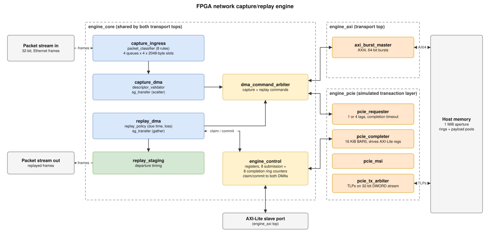

# FPGA network capture/replay engine

[](https://github.com/jchik1102/fpga-network-engine/actions/workflows/ci.yml)

A SystemVerilog packet capture, replay and impairment engine with scatter-gather DMA, built around one engine core (`rtl/engine_core.sv`) that runs on two memory transports: an AXI4 64-bit burst master with AXI-Lite control (`engine_axi`), and a simulated PCIe transaction layer with a 1- or 4-tag DMA requester, a 16 KiB BAR0 completer and MSI (`engine_pcie`). The core classifies Ethernet II/IPv4/UDP traffic into four capture queues, moves packets to host memory through eight descriptor rings with 1–4 segment scatter-gather, and replays them at their original or fixed intervals with per-queue delay and seeded loss. It is verified with UVM 1.2 agents and a register model in XSim, independent Python models, a record-by-record AXI-versus-PCIe comparison and a mutation campaign, and both tops fit the DE10-Lite's MAX 10 at 50 MHz. The PCIe side stops at the transaction layer: there is no PHY, data link layer, flow-control credits or enumeration, and nothing has run on hardware.



The diagram is an SVG with the draw.io model embedded; open `docs/block_diagram.svg` in draw.io to edit it.

**Demo video:** _placeholder — link to be added._

## Running it

Prerequisites (from the original setup, unchanged):

- Windows with Vivado/XSim 2025.2 at `C:\AMDDesignTools\2025.2\Vivado` (bundled UVM 1.2)
- Quartus Prime Lite 24.1std with MAX 10 support at `C:\intelFPGA_lite\24.1std`
- WSL2 Ubuntu (24.04 tested) with `python3`, `python3-venv` and `make`
- PowerShell 7 (`pwsh`). Windows PowerShell 5 aborts on Quartus's harmless stderr output. The Makefile uses `pwsh.exe` from `PATH`, or set `PWSH=/path/to/pwsh.exe`
- for `make formal` only: OSS CAD Suite in WSL (the 2026-10-14 build was used; it includes SymbiYosys, the yosys-slang plugin, Yices and Bitwuzla; versions in [versions.txt](results/formal/versions.txt)). `scripts/run-formal.sh` adds `~/oss-cad-suite/bin` to `PATH` if it exists
- optional: Wireshark/TShark at `C:\Program Files\Wireshark` (only `setup_checks/test_setup.py` uses it)

One-time setup, from WSL in the repository root:

```bash
bash scripts/setup-python.sh
```

Then:

| Command (WSL, repository root) | What it runs |
| --- | --- |
| `make models` | 41 Python model tests |
| `make test` | `scripts/run-all.ps1 -Seeds 17,29 -Mutations -Fit`, then `make results` |
| `make test-quick` | `scripts/run-all.ps1 -Seeds 17` |
| `make fpga` | Quartus fits of `engine_axi_fit` and `engine_pcie_fit` |
| `make results` | copies the logs and reports that back this README from `build/` into `results/` |
| `make formal` | SymbiYosys proofs and covers in `formal/` (needs OSS CAD Suite with the yosys-slang plugin on `PATH`); see "Formal verification" under [Results](#results) |

Per-step run times from the last full run are in [summary.txt](results/regression/summary.txt).

Each `make` target saves its console output under `results/`. The PowerShell scripts can still be run directly from PowerShell 7, as before:

```powershell
pwsh -NoProfile -File scripts/run-rtl.ps1 -Test engine_axi               # integrated AXI test
pwsh -NoProfile -File scripts/run-rtl.ps1 -Test engine_pcie              # PCIe, 1 tag, RCB 64
pwsh -NoProfile -File scripts/run-rtl.ps1 -Test engine_pcie -Label stress -Plusargs FOUR_TAG,RCB128,HIGH_APERTURE,HIGH_BAR
pwsh -NoProfile -File scripts/run-rtl.ps1 -Test pcie                     # requester unit test
pwsh -NoProfile -File scripts/run-mutations.ps1                          # 10 deliberate defects
pwsh -NoProfile -File scripts/run-fit.ps1 -Top engine_axi                # or engine_pcie
```

Other module tests are `-Test packet|axi|sg|control|replay`. Their fixtures come from `host.generate_{packet,dma,replay}_vectors`. Use `-Seed N` to pick the simulation seed. Run XSim jobs one at a time, because parallel runs share tool state. Each integrated run writes `export/capture.pcap`, `export/replay.pcap` (nanosecond PCAP that opens in Wireshark) and `export/ticks.json` under its `build/` directory.

## Continuous integration

[`.github/workflows/ci.yml`](.github/workflows/ci.yml) runs on every push and pull request, on GitHub's Ubuntu runners: the Python model tests and `scripts/run-formal.sh` (the SymbiYosys proofs and covers, with the same OSS CAD Suite build as `make formal`). The XSim/UVM regression and the Quartus fits need the Windows vendor tools, so `make test` and `make fpga` run locally and their logs are committed under `results/`.

## Results

Every number below is copied from a log in [`results/`](results/), produced by `make test` (seeds 17 and 29, mutations and both fits). [`results/PROVENANCE.txt`](results/PROVENANCE.txt) records the commit and date. Where a test reports per-seed values, the seed-17 value is shown.

**Regression**

| Check | Result | Log |
| --- | --- | --- |
| Full regression steps | 25 of 25 pass | [summary.txt](results/regression/summary.txt) |
| Python model tests | 41 passed | [models.log](results/regression/models.log) |
| Packet parser/classifier | 111 packets, 34,339 bytes checked, coverage 100% | [packet_seed17.log](results/regression/packet_seed17.log) |
| AXI burst master | 395 transactions, 24,776 byte checks, coverage 100% | [axi_seed17.log](results/regression/axi_seed17.log) |
| Scatter-gather | 76 cases (20 invalid, 4 bus errors), 23,328 bytes checked | [sg_seed17.log](results/regression/sg_seed17.log) |
| AXI-Lite control + RAL | 42,627 checks, 595 claims, 584 commits, 68 rejected writes; ring and bus coverage 100% | [control_seed17.log](results/regression/control_seed17.log) |
| Replay policy | 227 policies, 61 frames, 8 lost; coverage and policy coverage 100% | [replay_seed17.log](results/regression/replay_seed17.log) |
| PCIe requester unit | 4 tags outstanding, 346 cross-tag reorderings, 30 negative cases (6 unexpected, 4 late, 8 malformed, 2 poisoned completions, 4 timeouts), coverage 100% | [pcie_seed17.log](results/regression/pcie_seed17.log) |
| Integrated AXI | 157 completion records, 57 replay frames, 102,713 payload bytes and 8,037 guard bytes checked; record coverage 96.875% | [engine_axi_seed17.log](results/regression/engine_axi_seed17.log) |
| Integrated PCIe, 1 tag | 160 records, 57 replay frames, 103,689 bytes checked; record coverage 96.875% | [engine_pcie_seed17.log](results/regression/engine_pcie_seed17.log) |
| Integrated PCIe stress (4 tags, RCB 128, aperture and BAR0/MSI above 4 GiB) | 160 records, 57 replay frames, 103,689 bytes checked | [engine_pcie_stress_seed17.log](results/regression/engine_pcie_stress_seed17.log) |

**Mutation campaign:** all 10 injected defects detected by their intended checker ([mutations.log](results/regression/mutations.log)): bad final strobe, wrong SG byte, early departure, early completion, loss ignoring queue, wrong PCIe byte enable, wrong tag, early tag reuse, premature completion publication and a disabled byte checker.

**AXI vs PCIe:** no differences in either PCIe variant for either seed ([compare_seed17.log](results/regression/compare_seed17.log), [compare_seed29.log](results/regression/compare_seed29.log)). Replay output (57 frames), per-queue order, the 13 seeded-loss decisions and the completion records are identical. The comparison excludes the abort phase, the AXI WRITE_ERROR row and the PCIe MSI phase ([comparison_s17.json](results/comparison_s17.json)). Only timing differs, in ticks of 20 ns:

| Workload (seed 17) | AXI max lateness | PCIe 1-tag max lateness |
| --- | ---: | ---: |
| Original-time replay | 6,654 | 15,355 |
| Throughput burst | 23,565 | 46,011 |

**Throughput** (16 × 1514-byte frames, simulation at 50 MHz, seed 17, from [comparison_s17.json](results/comparison_s17.json)):

| Transport | Capture | Replay |
| --- | ---: | ---: |
| AXI | 155.6 MB/s | 50.59 MB/s |
| PCIe, 1 tag | 156.59 MB/s | 26.96 MB/s |
| PCIe, 4 tags | 154.51 MB/s | 24.09 MB/s |

Capture is close to the 4 B/tick ingress limit of the 32-bit stream. Replay is limited by a single gather engine with one read outstanding, and four-tag mode only overlaps the pieces of one command.

**Formal verification** (`make formal`, SymbiYosys with the yosys-slang frontend; [summary.txt](results/formal/summary.txt)). The two modules with the most protocol state are checked on their own, with every input free except for the assumptions listed below. "Proof" means unbounded: the property holds in every reachable state, not just up to a depth.

| Module | Task | What is checked | Result | Log |
| --- | --- | --- | --- | --- |
| `engine_control` | prove (k-induction, yices) | AXI-Lite slave: one response per request, responses held until accepted, only OKAY or SLVERR, read data from the address accepted at the AR handshake (ID register, `sq_producer[0]`, an unmapped address), a rejected write changes no configuration; for each of the 8 rings, a submission ring never holds more than 32 descriptors and completed plus reserved records never exceed the 64-entry completion ring | proof passes | [log](results/formal/engine_control_prove/logfile.txt) |
| `engine_control` | cover | an OKAY write, a SLVERR write, a ring register read, a claim followed by a commit | all 4 reached | [log](results/formal/engine_control_cover/logfile.txt) |
| `pcie_requester` | prove (ABC PDR) | no MRd on a tag that is still outstanding, single-tag mode uses only tag 0, every accepted completion belongs to an outstanding tag of this requester, an MRd TLP is never cut short on the TX stream | proof passes | [log](results/formal/pcie_requester_prove/logfile.txt) |
| `pcie_requester` | cover | two tags outstanding, a completion accepted, a tag quarantined, a tag reused after its completion | all 4 reached | [log](results/formal/pcie_requester_cover/logfile.txt) |

**Two RTL bugs found.** Neither was reachable by the UVM agents, and both are fixed (explained in [DESIGN.md](DESIGN.md#bugs-found-by-formal-verification)): `engine_control` decoded most read addresses from the live `ARADDR` instead of the address latched at the handshake, and `pcie_requester` could time out in the middle of sending an MRd and leave a truncated TLP on the link. [`scripts/formal-before-fix.sh`](scripts/formal-before-fix.sh) re-runs the proofs on the RTL from before each fix, and both fail ([before_fix/summary.txt](results/formal/before_fix/summary.txt)).

Assumptions and limits:

- The harnesses use immediate assertions in clocked blocks, because the yosys-slang frontend does not support concurrent SVA.
- `engine_control`: the AXI-Lite master keeps VALID and its payload stable until the handshake. Once the engine has been seen stopped and quiescent, no worker claims a descriptor until RUN; `engine_core`, `capture_dma` and `replay_dma` guarantee this, and without it a stale `claim_eligible` could over-claim a ring (DESIGN.md, decision 1). The proof also uses helper invariants (stated as assertions, so they are proved too) on the slave's handshake state and on what `claim_ready` implies about the counters.
- `pcie_requester` is checked with `TIMEOUT=8` instead of 65,536 so the timeout and quarantine paths are reachable; the logic does not depend on the value. The configuration inputs are held constant, no completion arrives during a drain reset, and a completion with this requester's ID never names a tag whose new MRd is still being sent (the transaction-layer limit listed under "Not tested or limited"). Foreign IDs and late completions for quarantined tags are unconstrained.
- Data movement (DMA payloads, scatter-gather, replay timing) is not checked formally; the simulation regression covers it.

**Quartus Prime Lite 24.1, 10M50DAF484C7G, 50 MHz:**

| Top | Logic elements | Memory bits | Setup slack (slow 85 °C) | Worst hold slack | Fmax (slow 85 °C) | Reports |
| --- | --- | --- | --- | --- | --- | --- |
| `engine_axi_fit` | 28,498 / 49,760 (57%) | 327,680 (20%) | +0.839 ns | +0.096 ns | 52.19 MHz | [fit](results/fit/engine_axi/engine_axi_fit.fit.summary), [sta](results/fit/engine_axi/engine_axi_fit.sta.summary), [Fmax](results/fit/engine_axi/engine_axi_fit.sta.rpt) |
| `engine_pcie_fit` | 29,551 / 49,760 (59%) | 327,680 (20%) | +0.911 ns | +0.099 ns | 52.39 MHz | [fit](results/fit/engine_pcie/engine_pcie_fit.fit.summary), [sta](results/fit/engine_pcie/engine_pcie_fit.sta.summary), [Fmax](results/fit/engine_pcie/engine_pcie_fit.sta.rpt) |

Both setup margins are under 1 ns, and the PCIe fit's router warned about congestion ([fit_engine_pcie.log](results/regression/fit_engine_pcie.log)).

**Board programming isn't set up.** The fit wrappers (`constraints/engine_fit.sv`) register every port, and `constraints/engine.tcl` turns all of them except `clk` into virtual pins. There is no DE10-Lite board top and no pin assignments, so the results show that the design fits and closes timing, but there's no `.sof` to program. Running on hardware would need a board top that wires the engine to an on-chip memory or the SDRAM, a packet source and sink, and the DE10-Lite pin file.

## Interface summary

Host memory is a 1 MiB aperture with these regions:

| Range | Use |
| --- | --- |
| `0x00000–0x3ffff` | control: rings and the 8-byte fence scratch word at `0x1f000` |
| `0x40000–0x7ffff` | capture payload pool |
| `0x80000–0xbffff` | replay payload pool |

On PCIe, host address = aperture base + offset, and it can be above 4 GiB.

**Descriptor (64 B):**

| Offset | Field |
| --- | --- |
| 0 | cookie |
| 8 | sequence |
| 12 | epoch |
| 16 | captured tick (replay) |
| 24 | capacity or length |
| 26 | segment count, 1–4 |
| 32 + 8i | segment i: address (4 B), length (2 B) |

**Completion record (32 B):**

| Offset | Field |
| --- | --- |
| 0 | cookie |
| 8 | sequence |
| 12 | epoch |
| 16 | tick |
| 24 | length |
| 26 | status: 0 OK, 1 UNSUPPORTED, 2 LOST, 3 BAD_DESC, 4 READ_ERROR, 5 WRITE_ERROR |
| 27 | queue |
| 28 | aux: matched rule, parsed-UDP flag |

All fields are little-endian. Ring counters are absolute 32-bit values.

**Registers** (AXI-Lite or BAR0, 16 KiB):

| Offset | Register |
| --- | --- |
| `0x0000` | ID `NET1` |
| `0x0008` | command: 1 RUN, 2 STOP, 4 ABORT |
| `0x000c` | status |
| `0x0010` | epoch |
| `0x0020`–`0x0028` | IRQ mask, conditions, W1C |
| `0x0030`–`0x003c` | sticky fault |
| `0x0040` | counter snapshot |
| `0x0100`–`0x0128` | replay mode, start, origin, interval, loss seed and threshold |
| `0x0140` | per-queue delays |
| `0x0200 + 32r` | classifier rules |
| `0x0400 + 64q` | capture rings |
| `0x0800 + 64q` | replay rings |
| `0x0c00` | drop counters |
| `0x1000`–`0x10ff` | PCIe transport (PCIe top only): four-tag mode, aperture base, error sticky bits, drain reset, counters |

Configuration writes need the engine quiescent. Bad accesses return SLVERR with no side effect. Register writes take effect on the second edge after AW and W are both held.

Replay timing:

- Original mode: `due = start + (capture_tick - origin) + queue_delay`
- Fixed mode: `due = start + seq*interval + queue_delay`

A packet never departs early. The loss decision is an xorshift hash of seed, sequence and queue, compared against a 33-bit threshold. It doesn't depend on stalls.

Design decisions and the reasoning behind them are in [DESIGN.md](DESIGN.md).

## Layout

| Path | Content |
| --- | --- |
| `rtl/` | synthesizable design; `engine_axi` (in `engine_core.sv`) and `engine_pcie` are the transport tops |
| `tb/` | UVM agents (stream, AXI memory, AXI-Lite + RAL, PCIe root complex), module benches, host software, integrated tests |
| `models/`, `host/` | independent Python models, fixture generators, PCAP/tick export and the AXI-vs-PCIe comparison |
| `tests/` | Python model tests and the published replay-loss vectors |
| `formal/` | SymbiYosys harnesses (`*_formal.sv`), `.sby` files and the task list run by `make formal` |
| `constraints/` | Quartus project script, SDC, registered fit wrappers, timing report scripts |
| `scripts/` | launchers; `run-all.ps1` runs the full regression, `collect-results.sh` gathers the evidence |
| `setup_checks/` | tool qualification benches used by `run-bounded.ps1` |
| `results/` | committed logs and reports behind the numbers in this README |
| `docs/` | block diagram |

## Problems hit during development

- **XSim ignored `$fatal` in its exit code.** The simulator returned exit 0 even after an HDL `$fatal`, so a failing test looked like a pass. `scripts/check-xsim-log.ps1` now scans each log for errors, fatals and watchdogs, and requires a per-test success marker.
- **Replay buffer built from flip-flops.** The first full-engine fit inferred the four byte-enabled replay head arrays as flip-flops and LUTs, several times the MAX 10's capacity. Rewriting them as a single 2048×32 RAM in Quartus's byte-enable template moved them into block RAM, and the engine dropped to 57–59% of the device.
- **TLP header silently truncated.** Every TLP's DW0 was built from a concatenation that was 36 bits wide, which shifted out the Fmt field. A CplD left the BAR completer looking like an MRd, and XSim gave no width warning. The independent host-side TLP decoder caught it, and all four encoders now use `{fmt,type,14'b0,length}`.
- **Coverage bins named with reserved words.** Bins called `small`, `medium` and `large` (plus identifiers `sequence` and `before`) are SystemVerilog keywords and broke compilation, so they were renamed.
- **Replay monitor sampled too early.** The replay monitor read metadata on the same edge as TLAST, before the DUT's nonblocking update had landed. It now samples on the following falling edge.
- The bundled UVM had no usable default timescale at elaboration, fixed with `xelab -timescale 1ns/1ps`.
- Comma-joined `-Seeds 17,29` reached the script as a single token (seed 1729) through `pwsh -File`, so the launchers now split comma lists.

## Not tested or limited

- Hard reset with bus transactions in flight is not exercised. The design assumes an external drain guarantee, and tag quarantine covers the case without one.
- A duplicate completion that exactly matches a reissued tag's byte count and lower address can't be detected at the transaction layer.
- The PCIe host model only guarantees read-flush ordering. This is deliberately weaker than real root complexes, so a missing fence would show up.
- Integrated record coverage is 96.875%, not 100%.
- Nothing has run on hardware: no physical Ethernet, PCIe, SDRAM or board.
